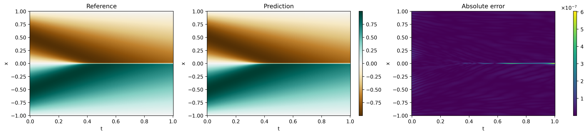
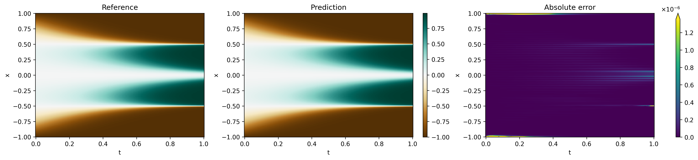
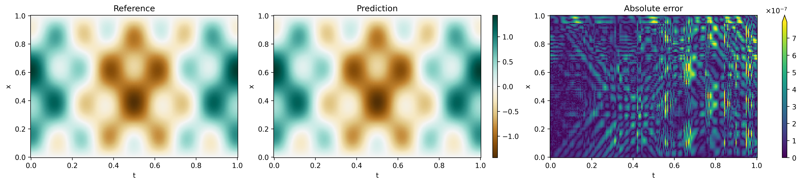
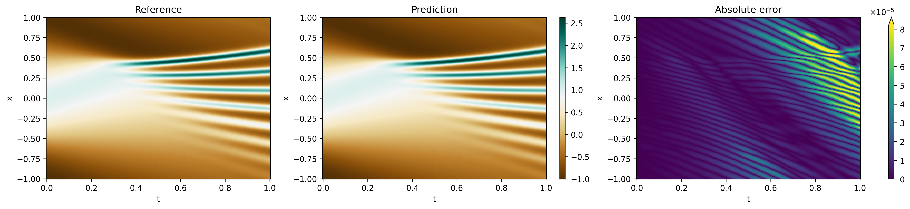
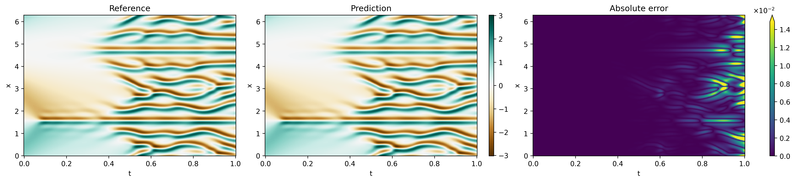
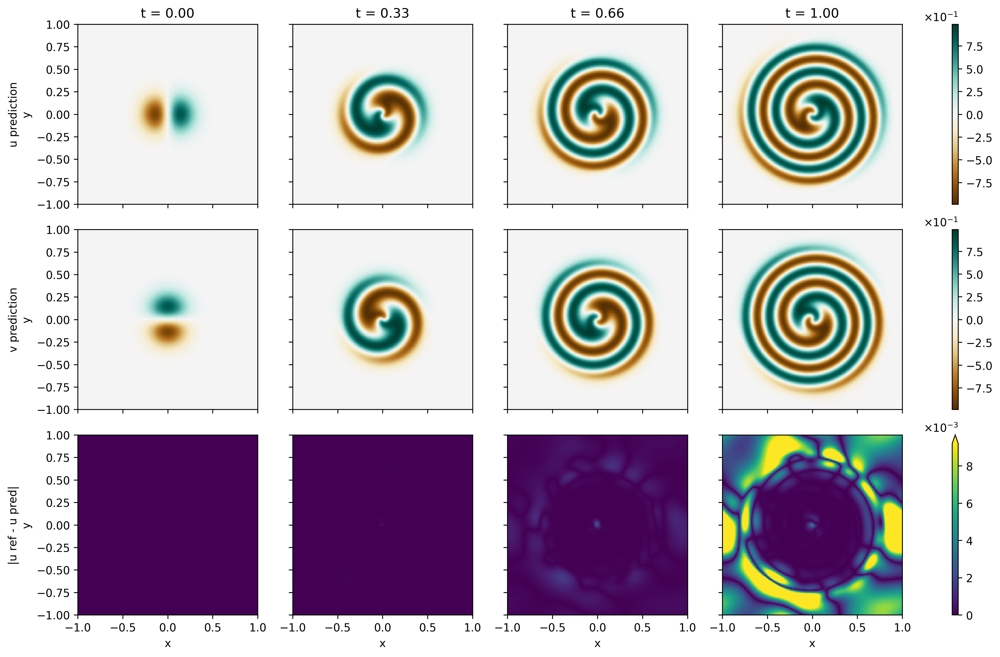
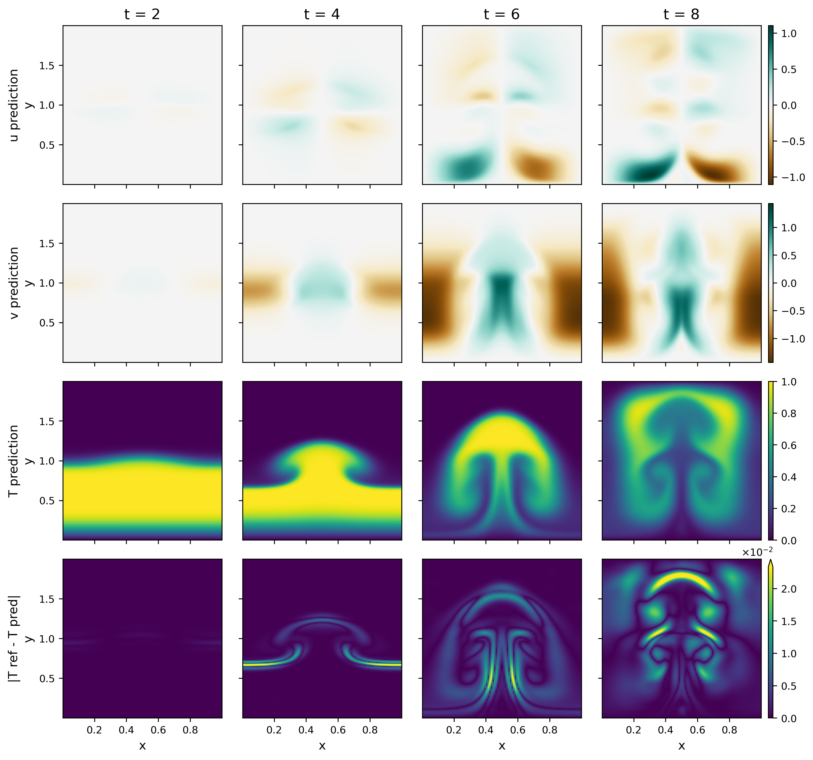

# PINNPipe

PINNPipe is a JAX/Flax library and benchmark suite for evaluating training
choices for physics-informed neural networks (PINNs): network architecture,
collocation sampling, loss balancing and optimization. It contains the code and
reference data for all experiments of our paper (see [Citation](#citation)).

<p align="center">
  
</p>
<p align="center"><em>Burgers, SOAP → SSBroyden (MLP 5×64, float64, seed 2): relative L2 error 3.4e-8.</em></p>

## Features

- **Architectures** (`pinnpipe/archs.py`): MLP, ModifiedMLP and PirateNet, with
  Fourier feature embeddings, periodic embeddings and weight factorization.
- **Optimizers**: Adam, SOAP, and SOAP followed by self-scaled Broyden
  quasi-Newton (SSBroyden) in float64.
- **Collocation samplers** (`pinnpipe/domain_importance_adapt.py`): uniform,
  grid, RAD, LAS, R3 and vRBA.
- **Loss balancing** (`pinnpipe/loss_balancing.py`): fixed weights, GradNorm,
  learning-rate annealing, ReLoBRaLo, SoftAdapt and GradNorm-MTL.
- **Training** (`pinnpipe/train.py`): physics-informed initialization,
  first-order → quasi-Newton training, time-window training for long horizons.
- **Nine benchmarks** with verified reference solutions.

## Benchmarks

| Benchmark | Directory | Reference solution |
|---|---|---|
| Wave (1-D) | `benchmarks/wave` | analytic |
| Heat (5-D) | `benchmarks/heat` | analytic |
| Poisson (5-D) | `benchmarks/poisson` | manufactured |
| Burgers | `benchmarks/burgers` | Fourier spectral + ETDRK4, rel. L2 1.9e-11 |
| Allen–Cahn | `benchmarks/allen_cahn` | Fourier spectral + ETDRK4, rel. L2 2.7e-9 |
| Korteweg–de Vries | `benchmarks/kdv` | Chebfun `spin`, ≈5e-12 |
| Kuramoto–Sivashinsky (chaotic) | `benchmarks/ks_chaotic` | Chebfun `spin`, ≈3e-9 |
| Ginzburg–Landau (2-D, complex) | `benchmarks/ginzburg_landau` | Chebfun `spin2`, ≈3e-8 |
| Rayleigh–Taylor (2-D Boussinesq) | `benchmarks/rayleigh_taylor` | external solver, independently validated |

[REFERENCE_SOLUTIONS.md](REFERENCE_SOLUTIONS.md) documents how every reference
was generated, how to regenerate it, and how its accuracy was measured.

### Gallery

PINN predictions against the reference solutions.

<table>
  <tr>
    <td width="50%"><br><em>Allen–Cahn</em></td>
    <td width="50%"><br><em>Wave</em></td>
  </tr>
  <tr>
    <td><br><em>Korteweg–de Vries</em></td>
    <td><br><em>Kuramoto–Sivashinsky</em></td>
  </tr>
  <tr>
    <td><br><em>Ginzburg–Landau</em></td>
    <td><br><em>Rayleigh–Taylor</em></td>
  </tr>
</table>

## Installation

Install JAX for your accelerator first (see the
[JAX installation guide](https://docs.jax.dev/en/latest/installation.html)),
then, from the repository root:

```bash
pip install -r requirements.txt
pip install -e .
```

The SOAP optimizer is included as `pinnpipe/soap.py` (SOAP_JAX v0.2.0 with bug
fixes; this is the version used in the paper), so no separate SOAP package is
needed.

## Running the experiments

Every benchmark directory contains one script per study:

| Script | Study | Methods | Config |
|---|---|---|---|
| `nn_size.py` | network architecture and size | MLP, ModifiedMLP, PirateNet; small, medium, large | `configs/nn_sweep.py` |
| `domain_importance_adaptation.py` | collocation sampling | uniform, R3, RAD, LAS, vRBA | `configs/sampler_sweep.py` |
| `loss_balancing.py` | loss balancing | fixed, GradNorm, GradNorm-MTL, ReLoBRaLo, SoftAdapt | `configs/loss_balancing_sweep.py` |
| `optim_f32.py` | optimizers, float32 | see below | `configs/optimizer_sweep.py` |
| `optim_f64.py` | optimizers, float64 | see below | `configs/optimizer_sweep.py` |

The optimizer study compares SOAP with SOAP → SSBroyden and includes a
network/precision ablation:

| Script | Optimizer | Network | Precision | Role |
|---|---|---|---|---|
| `optim_f32.py` | SOAP | PirateNet 3×256 | float32 | optimizer comparison |
| `optim_f32.py` | SOAP | MLP 5×64 | float32 | ablation |
| `optim_f64.py` | SOAP → SSBroyden | MLP 5×64 | float64 | optimizer comparison |
| `optim_f64.py` | SOAP | MLP 5×64 | float64 | ablation |
| `optim_f64.py` | SOAP | PirateNet 3×256 | float64 | ablation |

The optimizer study is split by precision because float64 has to be enabled
before JAX is imported. Run a study from its benchmark directory; the default
seed is 2, other seeds can be given as arguments:

```bash
cd benchmarks/allen_cahn
python optim_f64.py          # seed 2
python optim_f64.py 2 3 5    # seeds 2, 3 and 5
```

To run one study on all benchmarks (or a subset):

```bash
python benchmarks/run_all.py loss_balancing
python benchmarks/run_all.py optim_f64 --benchmarks burgers allen_cahn --seeds 2 3
```

Hyperparameters (network sizes, step counts, learning rates, batch sizes) are
set in each benchmark's `configs/` directory.

### Prediction plots

Every benchmark except Heat and Poisson has two plotting scripts.
`save_final_prediction.py` trains one optimizer-study run (default: SOAP →
SSBroyden, seed 2, float64) and stores its prediction on the reference grid;
`plot_saved_prediction.py` plots it against the reference. For the benchmarks
in one space dimension the figure shows reference, prediction and absolute
error over (t, x); for Ginzburg–Landau and Rayleigh–Taylor it shows the
predicted fields and the absolute error of one field at selected times
(`--times`).

```bash
cd benchmarks/burgers
python save_final_prediction.py --opt Soap_SSBroyden2 --seed 2
python plot_saved_prediction.py    # figures/Soap_SSBroyden2_Mlp_64_5_2/burgers_prediction.png
```

## Adding a new method

Each study script lists the methods it runs at the top (`ARCHITECTURES`,
`SAMPLERS`, `SCHEMES` or `CASES`). To test a new method:

1. **Implement it in the library** and register it under a name:

   | Method | Implement in | Register in | Selected by |
   |---|---|---|---|
   | Collocation sampler | `pinnpipe/domain_importance_adapt.py` | `get_sampler` | `config.dia.type` |
   | Loss balancing | `pinnpipe/loss_balancing.py` | `create_loss_balancer` | `config.weighting.scheme` |
   | Architecture | `pinnpipe/archs.py` | `_create_arch` in `pinnpipe/models.py` | `config.arch.arch_name` |
   | First-order optimizer | `pinnpipe/models.py` | `_create_optimizer` | `config.optim.optimizer` |
   | Quasi-Newton optimizer | `pinnpipe/train.py` | `get_quasi_newton_opt` | `config.optim.optimizer` |

   An optimizer name can name both stages: `Soap_SSBroyden2` trains with SOAP
   for `first_order_steps` and then with SSBroyden for `second_order_steps`.

2. **Add a setting** for it to the benchmark's config, next to the existing
   ones. For a sampler, for example, add a branch to `get_config` in
   `benchmarks/<benchmark>/configs/sampler_sweep.py`:

   ```python
   elif dia_method == "my_sampler":
       dia.type = "my_sampler"
       dia.batch_size = 64 * 128
       dia.batch_size_eval = None
   ```

3. **Add its name** to the list in the study script and run it:

   ```python
   SAMPLERS = ["uniform", "R3", "rad", "las", "vRBA", "my_sampler"]
   ```

   ```bash
   cd benchmarks/<benchmark> && python domain_importance_adaptation.py
   ```

A new benchmark is a new directory with `models.py` (PDE residuals, losses,
evaluator), `utils.py` (reference data), `configs/` and the five study scripts;
copying an existing benchmark is the easiest start.

## Logging

Runs are logged to [Weights & Biases](https://wandb.ai) under projects named
after benchmark and study (e.g. `Burgers-OptSweep`, `Wave-SamplerSweep`). To
run without a W&B account, set

```bash
export WANDB_MODE=offline    # or: export WANDB_MODE=disabled
```

Checkpointing is off in all configs (`config.saving`); when enabled,
checkpoints are written below the current working directory.

## Repository layout

```text
pinnpipe/                  library
  archs.py                 network architectures
  models.py                PINN base class and optimizer setup
  train.py                 training and evaluation loops
  domain_importance_adapt.py   collocation samplers
  loss_balancing.py        loss-balancing schemes
  broyden.py               self-scaled Broyden quasi-Newton optimizer
  soap.py                  SOAP optimizer
benchmarks/
  run_all.py               run one study on all benchmarks
  <benchmark>/
    nn_size.py, domain_importance_adaptation.py, loss_balancing.py,
    optim_f32.py, optim_f64.py     study scripts
    save_final_prediction.py, plot_saved_prediction.py
                           prediction plots (all but heat and poisson)
    configs/               ml_collections configs, one per study
    models.py              PDE residuals, losses and evaluator
    utils.py               reference data loader
    data/                  reference data and generation scripts
docs/figures/              prediction plots
verify_reference_solutions.py   independent check of the spectral references
REFERENCE_SOLUTIONS.md     provenance and accuracy of all references
```

## Citation

The paper has been accepted; its citation will be added here once it is
published.

## License and acknowledgements

PINNPipe is licensed under the Apache License 2.0 (see [LICENSE](LICENSE) and
[NOTICE](NOTICE)).

- The network architectures and the KdV, Kuramoto–Sivashinsky, Ginzburg–Landau
  and Rayleigh–Taylor reference data (with their Chebfun generation scripts)
  are adapted from [jaxpi](https://github.com/PredictiveIntelligenceLab/jaxpi)
  (Apache License 2.0).
- `pinnpipe/soap.py` is adapted from
  [SOAP_JAX](https://github.com/haydn-jones/SOAP_JAX) (MIT License).
- The Chebfun-based references require MATLAB with
  [Chebfun](https://www.chebfun.org); `verify_reference_solutions.py`
  reproduces them with NumPy/SciPy.
